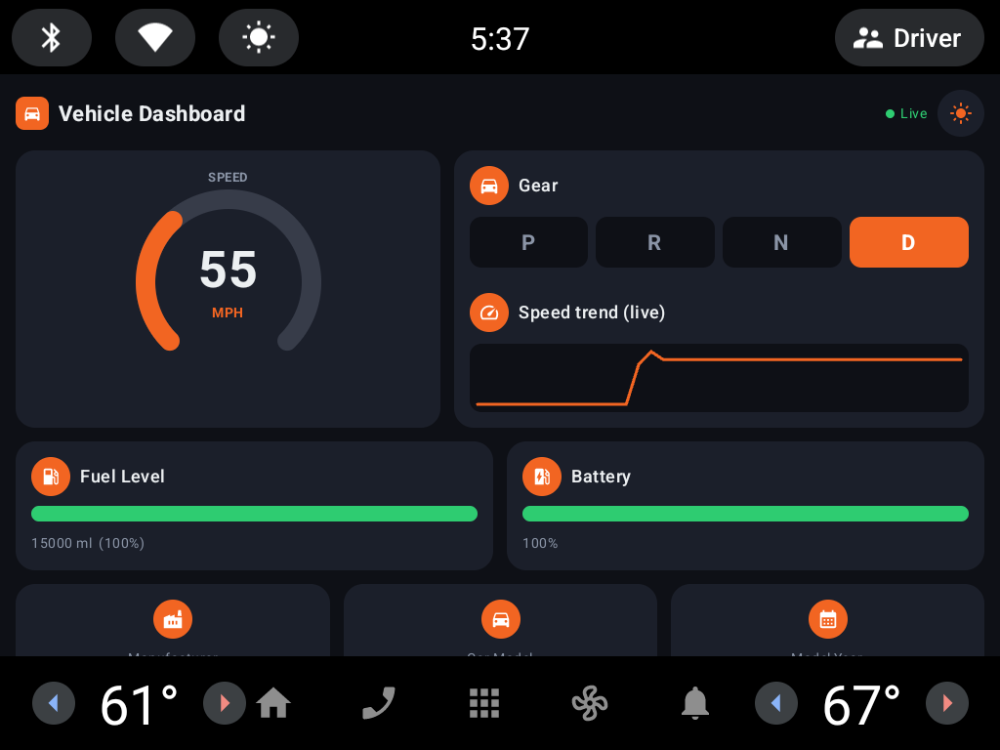
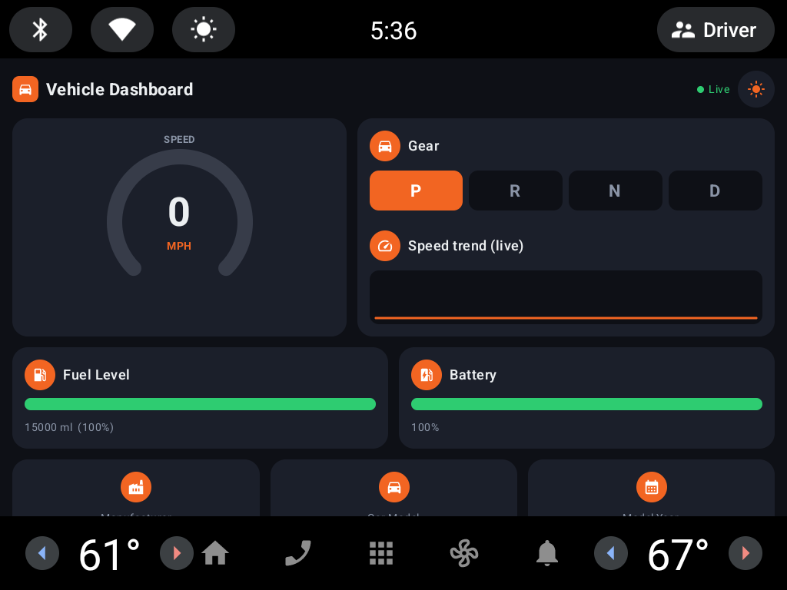
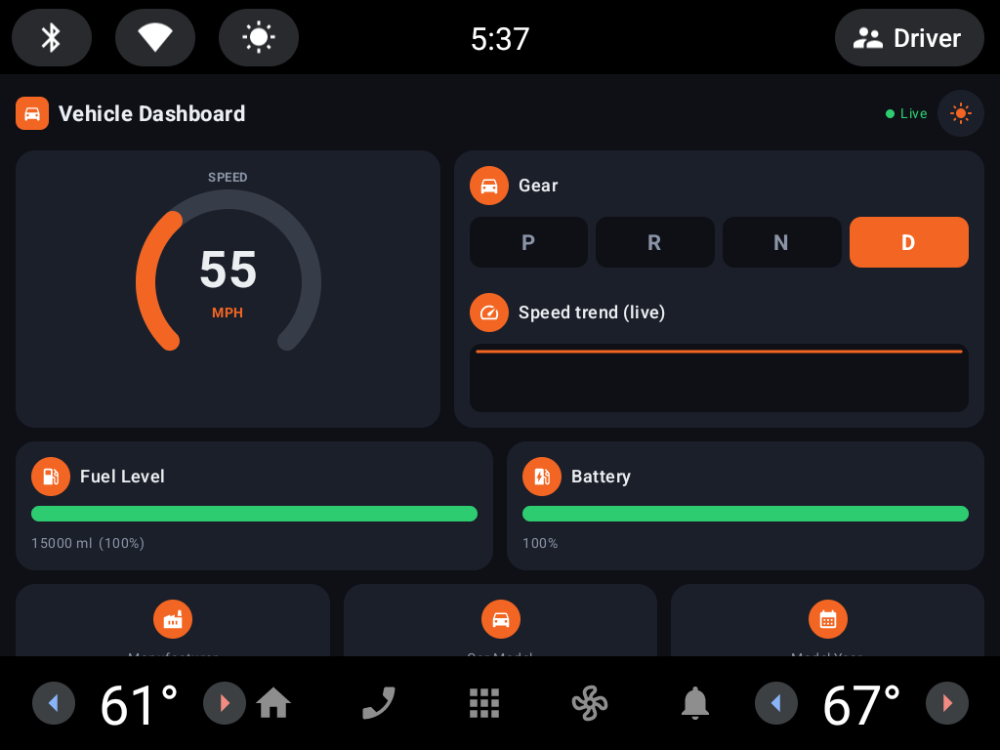

# AAOS Interactive Learning Series

Hands-on modules for **Android Automotive OS** development — each one a complete, working app plus the
full record of how it was built: the environment, the emulator, the API, the dead ends, and the results.

### ▶ [Open the interactive presentation](https://crstef.github.io/AAOS-interactive-learning-series/)

A self-contained deck that includes a **live replica of the dashboard** you can drive with sliders — no
emulator, no Android Studio, no install.

---

## Module 01 — Simple Vehicle Property Dashboard

> Capstone Project 1 · Individual · 5 working days

An AAOS app that connects to the vehicle HAL through the **Car API**, reads real-time vehicle signals with
`CarPropertyManager`, and renders them on an automotive-optimised dashboard built in **Kotlin + Jetpack
Compose**. Values update by themselves the moment a signal changes in the emulator.

📁 **[module-01-vehicle-property-dashboard/](module-01-vehicle-property-dashboard/)**

  

### What it does

| | |
|---|---|
| **Speed** | Circular gauge, colour-graded, with a live 40-point speed-trend sparkline |
| **Gear** | P / R / N / D selector row that highlights the active gear |
| **Fuel** | Meter bar in millilitres and percent, with a red **LOW FUEL** alert under 15 % |
| **Battery** | EV charge meter, shown only when the vehicle actually reports it |
| **Range / Odometer** | Live trip statistics |
| **Vehicle info** | Manufacturer, model, model year |
| **Theming** | Day / night toggle |
| **Connection** | A "● Live" indicator that reflects the real Car service connection state |

### Documentation

The build is written up end to end, each document grounded in the source it describes:

| Document | What it covers |
|---|---|
| [01 — Environment setup](module-01-vehicle-property-dashboard/docs/01-environment-setup.md) | Relocating the entire Android toolchain off a full system drive, and why the order matters |
| [02 — Emulator and AVD](module-01-vehicle-property-dashboard/docs/02-emulator-and-avd.md) | The automotive virtual device, its real configuration, and where `android.car.jar` actually lives |
| [03 — Architecture](module-01-vehicle-property-dashboard/docs/03-architecture.md) | The five Kotlin files, and how one property callback becomes a redrawn screen |
| [04 — Car API walkthrough](module-01-vehicle-property-dashboard/docs/04-car-api-walkthrough.md) | `Car.createCar()` → `CarPropertyManager` → `registerCallback()`, with real code |
| [05 — Properties and units](module-01-vehicle-property-dashboard/docs/05-properties-and-units.md) | Every property read, its raw unit, and the conversion applied |
| [06 — What cannot be read](module-01-vehicle-property-dashboard/docs/06-what-cannot-be-read.md) | Why engine RPM, coolant temperature and door status are unavailable to any normally-installed app |

### Requirements coverage

Mapped against the capstone brief:

| Objective | Status | Where |
|---|---|---|
| Connect to the vehicle HAL layer through the AAOS Car API | ✅ | [`VehicleDashboardViewModel.connect()`](module-01-vehicle-property-dashboard/app/src/main/java/com/infosys/cardashboard/VehicleDashboardViewModel.kt) |
| Retrieve real-time vehicle data (speed, fuel level, …) | ✅ | 6 live + 3 static properties — see [doc 05](module-01-vehicle-property-dashboard/docs/05-properties-and-units.md) |
| Display signals on an automotive-optimised dashboard UI | ✅ | [`DashboardScreen.kt`](module-01-vehicle-property-dashboard/app/src/main/java/com/infosys/cardashboard/ui/DashboardScreen.kt) |
| Automatically update values when signals change | ✅ | `registerCallback(…, SENSOR_RATE_ONCHANGE)` |
| Must run on the Android Automotive emulator | ✅ | 3 emulator screenshots below |
| Handle CarApp permissions | ✅ | Manifest **and** runtime — see [doc 04](module-01-vehicle-property-dashboard/docs/04-car-api-walkthrough.md#permissions-are-a-two-step-process) |
| Follow automotive UI/UX best practices | ✅ | Landscape, large touch targets, `distractionOptimized` |

All three **optional** enhancements from the brief were implemented as well:

| Optional enhancement | Status |
|---|---|
| Alerts (e.g. low fuel warning) | ✅ Red bar + `LOW FUEL` badge below 15 % |
| Theme customisation (day / night mode) | ✅ Toggle in the top bar |
| Historical trends (speed graph) | ✅ Rolling 40-sample sparkline |

### Deliverables

| Deliverable | Location |
|---|---|
| Working AAOS application | [Gradle project](module-01-vehicle-property-dashboard/) — opens directly in Android Studio |
| Presentation slides | [`slides/`](module-01-vehicle-property-dashboard/slides/) + the [interactive deck](https://crstef.github.io/AAOS-interactive-learning-series/) |
| Emulator screenshots | [`screenshots/`](module-01-vehicle-property-dashboard/screenshots/) |
| Source code with documentation | [`app/src/`](module-01-vehicle-property-dashboard/app/src/) + [`docs/`](module-01-vehicle-property-dashboard/docs/) |

### Screenshots

| Parked, connected | Driving at 55 MPH | Speed trend building |
|---|---|---|
|  |  |  |

---

## Stack

`Android Automotive OS` · `Kotlin` · `Jetpack Compose` · `Material 3` · `Car API` · `Gradle KTS`

## Reference

[`VehiclePropertyIds`](https://developer.android.com/reference/android/car/VehiclePropertyIds) — the
authoritative list of vehicle properties available through the Car API.
